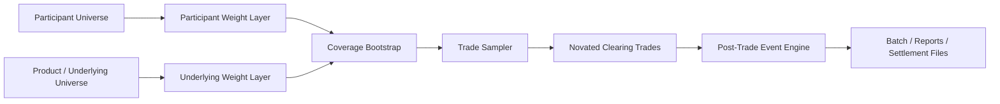
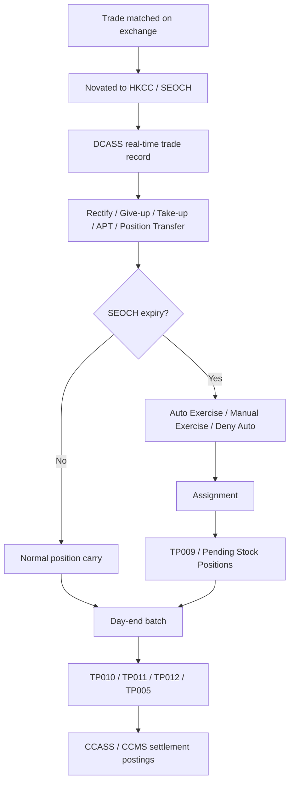

# HKEX 衍生品清算测试用 DailyTradeSimulationGenerator 的 participant 与 product 权重分配方案

## 执行摘要

这份方案把生成器拆成两层权重：**participant 层**决定“谁来成交”，**product / underlying 层**决定“成交什么”。两层之上再叠加一个**覆盖兜底层**，强制保证“每个 participant 至少有交易、每个 underlying 至少被触发一次”。如果用户给的目标交易数小于 `max(参与者数, underlying 数)`，生成器不应静默降级，而应自动上调目标值或直接报错，因为这是数学上无法同时满足的约束。这个判断是设计要求本身，不依赖市场规则。  

在清算边界上，这个生成器必须同时支持 urlHKCCturn11view0 与 urlSEOCHturn11view1 两套规则：HKCC 处理期货与指数期权等产品，SEOCH 处理股票期权；两者都通过 DCASS 接收已在交易所有效撮合完成的合约记录并实时更新 trade records，但账户结构、exercise/assignment、deliveries、CCASS/CCMS 交收与若干 post-trade 行为有所不同。citeturn29search11turn11view0turn11view1  

正式 participant 分类上，HKCC 有 **CP / GCP** 两类；SEOCH 有 **DCP / GCP** 两类。到 2024 年底，HKCC 有 133 名 participant（124 CP、9 GCP），SEOCH 有 68 名 participant（58 DCP、10 GCP）。这意味着测试生成器不应只建一个“均匀 participant 池”，而应至少支持“自清 / 第三方清算 / 代理经纪 / 做市 / 自营”几个角色层。citeturn30search2turn30search1turn11view0turn11view1  

在系统实现上，DCASS Terminal 是 urlHKEXturn8search14 定制的 urlNasdaqhttps://www.nasdaq.com client application，适合低到中等清算量的手工 post-trade 输入；高成交量参与者则可以通过 DCASS OAPI 做 host-to-host STP。HKEX 在 DCASS 手册中甚至直接把“约 10,000 笔日交易”视为 medium clearing volume。这个事实对你的生成器很关键：**50 trades/day 的功能性测试**与 **100k trades/day 的压力测试**，不只是量级不同，而是数据生成、状态存储、回报表、并发模型都应不同。citeturn12search0  

权重校准上，HKCC 推荐用 **HSI / HSCEI / Mini 系列 / Stock Futures / USD/CNH** 做主骨架。HSI Futures 合约乘数为 HK$50/点，交易时段覆盖日盘与夜盘；HSCEI Futures 也覆盖日盘与夜盘；Mini-HSCEI Futures 合约乘数为 HK$10/点；USD/CNH Futures 合约规模为 USD100,000，且是可交割货币期货。另一方面，SEOCH 推荐优先覆盖 **Tencent、Alibaba、HKEX、HSBC、AIA、CNOOC、BYD、China Mobile、JD、Baidu** 等活跃单一股票期权类别，因为这些类别在官方周报中的成交量和 open interest 显著高于长尾类别。citeturn39view0turn39view1turn38view2turn38view1turn39view3turn39view4turn23view0turn24view0turn25view1  

最重要的动态权重因子不是普通换月，而是 **corporate action，尤其是 spin-off**。在真实案例里，SEOCH/HKFE 会把原 series 迁移到 temporary symbol、暂停 temp series 交易、上市日后按 VWAP 确定 entitlement 价值，再迁移到 adjusted symbol，并通过 TP011、TP009、TP010、TP012 等报表反映。Wharf、Sunac、Haidilao 的官方 circulars 已经把这条生命周期讲得非常清楚。你的生成器如果不把这个动态状态机建进去，那就只能覆盖“正常日”，无法真正覆盖港交所衍生品清算的复杂路径。citeturn13search0turn13search1turn13search6turn13search3turn17view0turn18view0turn35search6turn35search8turn35search16  

## 快速配置清单

下表是给工程师直接落地的最小配置清单。表内“默认值”是本报告建议值，不是 HKEX 官方参数。

| 配置项 | 建议值 | 说明 |
|---|---:|---|
| `venue_scope` | `["HKCC","SEOCH"]` | 同时支持两套 clearing rule |
| `target_trades_per_day` | `max(50, P, U)` | 至少不小于 participant 数 P 与 underlying 数 U 的较大者 |
| `participant_source` | 官方 participant roster；缺失时用角色模板 | 角色模板见后文 |
| `participant_weight_model` | `role + hist_share + activity + account_mix + smoothing` | 两层权重中的第一层 |
| `product_weight_model` | `venue + liquidity + OI + expiry + CA + rollover` | 两层权重中的第二层 |
| `coverage_floor_per_participant` | `1` | 每 participant 至少一笔 |
| `coverage_floor_per_underlying` | `1` | 每 underlying 至少一笔 |
| `session_mode` | `batch` / `exchange` | 批量模式或类真实时段模式 |
| `random_seed` | 固定，如 `20260511` | CI 可复现 |
| `ca_calendar` | 可空 | 若存在 spin-off / rights / special dividend，则启用动态加权 |
| `post_trade_events` | 开启 | give-up/take-up、rectify、position transfer、exercise、cover/decover |
| `required_outputs` | 见后文 | trade list、positions、TP009/010/011/012、CCMS postings、margin calls |
| `fail_fast_on_insufficient_target` | `true` | 避免无意义的“伪覆盖” |

上面的清单必须和 DCASS 的可用 post-trade 功能对齐。DCASS 用户手册明确列出 HKCC / SEOCH 能处理的 post-trade input 与 on-behalf-of request，包括 rectify、give up / take up、APT、position transfer / netting、cover / decover、exercise / exercise adjustment、exercise criteria input。citeturn37view1turn15view0  

下面这张图是推荐的最小架构。



## 目标与约束

### 生成器的业务边界

DCASS 是 listed derivatives 的单一清算与交收系统。交易一旦在交易所有效成交，合约细节会自动传送到 HKCC / SEOCH，并实时更新在 DCASS。换句话说，DailyTradeSimulationGenerator 不应该再去模拟“订单簿撮合逻辑本体”，而应该把重点放在 **novation 后 clearing trade 的生成**，再向后叠加 post-trade 与 clearing lifecycle。citeturn29search11  

HKCC 的 participant 有两类：**CP** 只清自己的 proprietary 与 client；**GCP** 还可以替 NCP 做第三方清算。SEOCH 的 participant 有两类：**DCP** 只清自己的 proprietary 与 client；**GCP** 可为其他 options trading exchange participants 提供第三方 clearing。这个“正式 clearing 类别”应作为生成器 participant 主数据的第一层标签。citeturn11view0turn11view1turn30search2turn30search1  

如果用户没有给出 participant 名单、目标日交易量、时段窗口、历史成交份额、本地业务例外，则本方案按“**无特定约束**”处理，并给出合理默认值：participant 用角色模板生成；交易量按测试档位生成；session 采用产品默认时段模板；历史份额先用官方集中度指标与角色先验近似，等接入真实历史数据后再校准。官方确实披露了 HSI Futures 的 participant 集中度、交易所参与者数量，以及 stock options / stock futures 的官方市场统计，因此默认模型并不是完全凭空拍脑袋。citeturn21view0turn8search6turn22search16turn26search1  

### 账户与持仓层约束

HKCC 的核心清算账户至少包括 House、Omnibus Client、Individual Client、Client Offset Claim、Daily、Sink、APT；SEOCH 则有 House、Omnibus Client、Individual Client、Client Offset Claim、Market Maker、Daily、APT、Sink，以及特定场景下的 OBEP / designated trader 账户。House 通常按净额维持，Omnibus Client / Sink / Daily 等若干账户按总额或特殊方式计 margined；APT 不留 position。citeturn37view2turn31view2turn31view0turn31view1turn10view0turn10view1  

这意味着 participant 权重不仅要分配“这家公司有多少交易”，还要分配“这家公司这些交易更像落在哪一类 account”。否则你会生成很多看似合理、但在 clearing 层完全不真实的流。例如把 market maker 的大量流量落到 Omnibus Client，或者让 Sink Account 长期持有大量最终仓位，都会偏离 DCASS 的真实使用方式。citeturn31view1turn31view2turn10view0turn10view1  

### 覆盖兜底的硬约束

本方案把兜底定义为两条硬约束：

- 每个 participant 至少出现一次；
- 每个 underlying 至少出现一次。

若目标交易数 `N` 小于 `max(P, U)`，则必须自动上调到 `max(P, U)` 或报错。  
若 `N >= max(P, U)`，则先做覆盖 bootstrap，再做剩余交易的随机分配。  
这个“先覆盖、再随机”的顺序，是保证测试覆盖率最简单而可靠的方式。

## 参与者权重方案

### 正式 clearing 类别与业务角色的映射

正式 clearing 类别不足以描述真实流量风格，所以推荐在 participant 主数据中使用**双标签**：

- **Formal clearing class**：HKCC `CP/GCP`；SEOCH `DCP/GCP`
- **Business role**：`market_maker`、`agency_broker`、`bank_or_global_broker`、`proprietary_firm`

`market_maker` 不是 clearing category，而是产品/市场角色。HKEX 官方说明 stock options 市场存在 PMM、CQMM、QRMM 三类做市安排，并公开列出 listed derivatives 的 market makers / liquidity providers。公开名单中可以看到例如 urlOptiver Hong Kongturn20search3、urlHSBC Brokingturn20search2、BNP Paribas Securities (Asia) Limited、Citadel Securities (Hong Kong) Limited、Susquehanna Hong Kong Limited 等在不同产品上承担做市或流动性提供。citeturn22search2turn9view0turn26search16  

`bank_or_global_broker` 与 `agency_broker` 往往体现在 GCP / DCP/CP 上。官方 GCP 列表可见例如 urlABN AMRO Clearing Hong Kong Limitedturn20search0、urlGoldman Sachsturn20search1、urlHSBC Brokingturn20search2 等。它们适合作为“高活跃、大客户、多 account、多 give-up / take-up”的模板 participant。citeturn9view1turn9view2  

### 参与者权重的参数化模型

建议 participant 基础分数定义为：

\[
s_i
=
\theta_{\text{role}}(r_i)
+
\theta_{\text{clear}}(c_i)
+
\theta_{\text{mm}} \cdot \mathbf{1}_{mm_i}
+
\theta_{\text{hist}} \cdot \log(1+h_i)
+
\theta_{\text{act}} \cdot a_i
+
\theta_{\text{acct}} \cdot m_i
\]

其中：

- \(r_i\)：business role
- \(c_i\)：formal clearing class
- \(mm_i\)：是否 market maker / liquidity provider
- \(h_i\)：历史成交份额或市场份额代理变量
- \(a_i\)：近期活跃度
- \(m_i\)：账户结构复杂度或 account mix 指标

然后做拉普拉斯平滑：

\[
p_i = \frac{s_i + \lambda}{\sum_k (s_k + \lambda)}
\]

再对日度扰动使用 Dirichlet 先验：

\[
\tilde{p}^{(d)} \sim Dirichlet(\kappa_p \cdot p)
\]

这样可以同时获得：

- 长期稳定的 participant 分布；
- 每天略有波动的自然性；
- 低权重 participant 不至于被完全压成 0。

### 覆盖兜底机制

推荐两阶段分配。

第一阶段做 participant / underlying 覆盖：

1. 给每个 participant 至少分 1 笔；
2. 给每个尚未覆盖的 underlying 再分 1 笔；
3. 这部分交易按兼容矩阵 \(C_{i,u}\) 选 pair。

第二阶段对剩余交易数 \(N'\) 做概率抽样：

\[
\rho_{i,u} = \tilde{p}_i \cdot \tilde{q}_{u|v} \cdot C_{i,u}
\]

\[
n_{i,u} \sim Multinomial(N', \bar{\rho})
\]

如果你想让低权重 participant 也长期有“存在感”，可以把底噪写成：

\[
\tilde{p}_i' = (1-\omega_p)\tilde{p}_i + \omega_p \cdot \frac{1}{P}
\]

典型建议：  
`λ = 0.5 ~ 2.0`，`κ_p = 100 ~ 1000`，`ω_p = 0.01 ~ 0.05`。  

### 建议的 participant 角色基准权重

下表是**无真实历史成交份额时**的默认基准。它是工程建议，不是官方统计。

| Business role | 建议基准权重 | 说明 |
|---|---:|---|
| bank_or_global_broker | 0.34 | 适合作为 GCP / clearing-heavy participant 主体 |
| agency_broker | 0.28 | 客户流为主，给较高 client account 占比 |
| market_maker | 0.22 | 高频、重复性强、偏 House / MM account |
| proprietary_firm | 0.16 | 自营、方向性或对冲组合交易 |

如果导入真实市场份额数据，建议把上表仅作为先验，把历史 activity 覆盖到 \(h_i\) 与 \(a_i\)。官方 HSI Futures 市场份额披露显示，Top 10 参与者合计常常占到约 70% 的 long+short turnover，说明**头部集中、尾部稀疏**是更接近现实的先验。citeturn21view0  

### 建议的 account mix

下表同样是实现建议，但其方向与 DCASS 账户规则保持一致：Daily / APT 更适合作为工作流中间态，Sink 只能是残留与异常回收态，不能长期充当主账户。citeturn31view1turn31view2turn10view0turn10view1  

| 角色 | House | Omnibus Client | Individual Client | Market Maker | Client Offset Claim | Daily/APT | Sink |
|---|---:|---:|---:|---:|---:|---:|---:|
| market_maker | 0.70 | 0.05 | 0.00 | 0.20 | 0.00 | 0.05 | 0.00 |
| proprietary_firm | 0.80 | 0.05 | 0.00 | 0.10 | 0.00 | 0.05 | 0.00 |
| agency_broker | 0.10 | 0.55 | 0.20 | 0.00 | 0.05 | 0.08 | 0.02 |
| bank_or_global_broker | 0.15 | 0.35 | 0.25 | 0.05 | 0.15 | 0.03 | 0.02 |

### participant-level 事件概率建议

这些数值是测试建议，不是官方统计，可供第一版实现使用：

\[
Pr(e \mid x)=\sigma(\beta_e^\top x)
\]

其中 \(x\) 可包含：participant role、account type、block trade flag、expiry proximity、CA flag、NCP routing flag、session type。

建议的无校准起始值：

| 事件 | HKCC 基线 | SEOCH 基线 | 建议说明 |
|---|---:|---:|---|
| give-up / take-up | 0.5%–1.5% 交易 | 1%–3% 交易 | 代理流、第三方清算、客户指定清算时提高 |
| rectify | 0.1%–0.5% 交易 | 0.1%–0.5% 交易 | 开平修正、trade split、account transfer |
| external position transfer | 0.05%–0.3% 日 | 0.05%–0.3% 日 | 主要在 T/T+1 之后或跨 participant 调仓 |
| average price trade | 0.2%–1% 交易 | 0.2%–1% 交易 | 批量分配与平均价成交 |
| exercise request | N/A 或极低 | 非到期日 0.2%–1%；到期日按 ITM long 5%–15% | SEOCH 才是关键路径 |
| deny auto exercise | N/A | 自动生成 exercise 中的 1%–5% | 只在 expiry 场景显著 |

之所以 SEOCH 的 give-up / take-up、exercise 需要单独拉高，是因为 SEOCH 规则明确写明：trade give-up / take-up 可以在 T 或 T+1 完成，exercise request 在 cutoff 前可 reject / amend，expiry 日还存在 DCASS 自动生成 exercise request 与 deny auto 的流程。citeturn33view2turn16view3turn16view0turn16view1  

## 产品与标的权重方案

### HKCC 产品骨架与建议初始权重

HKCC 层建议优先覆盖以下产品骨架。下表中的权重是工程建议，右侧理由则来源于官方产品规格、交易时段、市场集中度和活跃度披露。

| 产品族 | 建议权重 | 说明 |
|---|---:|---|
| HSI Futures | 0.22 | 主力指数期货骨架 |
| HSI Options | 0.08 | 补足 HKCC 的期权路径 |
| HSCEI Futures | 0.14 | 另一条核心指数骨架 |
| HSCEI Options | 0.05 | 指数期权路径 |
| Mini-HSI Futures | 0.10 | 小合约、适合拉开 participant 结构 |
| Mini-HSCEI Futures | 0.05 | 小合约、补小 notional |
| Stock Futures Basket | 0.18 | 单股期货清算路径 |
| USD/CNH Futures | 0.08 | 外汇、可交割、日夜盘 |
| Other Currency Futures | 0.03 | EUR/CNH、JPY/CNH、AUD/CNH 等长尾 |
| Long tail / other HKCC products | 0.07 | 预留其他指数或商品 |

HSI Futures 是最容易成为 participant 权重校准锚点的 HKCC 产品：官方合约摘要给出 HKATS code 为 HSI，合约乘数 HK$50/点，交易时段为 9:15–12:00、13:00–16:30、17:15–3:00；而 HSI Futures 的 participant 市场份额披露又说明头部集中度很高。citeturn39view0turn39view1turn21view0  

HSCEI Futures 也覆盖日盘和夜盘。Mini-HSCEI Futures 的官方摘要给出 HKATS code 为 MCH，合约乘数 HK$10/点。USD/CNH Futures 官方摘要给出交易代码 CUS、合约规模 USD100,000、白天 8:30–18:30、夜盘 19:15–3:00，且结算方式为“seller deliver USD / buyer pay RMB”的可交割模式。citeturn38view2turn38view1turn39view3turn39view4  

对于 Stock Futures，HKEX 官方产品页直接提醒：单股期货**可能有或没有 market makers**，交易者应注意流动性风险。因此测试里不建议把所有 stock futures 均匀抽样，而应优先选高辨识度、高活跃的几只，例如 Tencent、Alibaba、HKEX、HSBC、AIA、China Mobile、CNOOC 等，并把长尾单股期货放在“低频强制覆盖桶”里。citeturn26search4turn28view0turn28view2turn28view3turn28view4turn27view0  

### 建议的 HKCC stock futures 子篮子

| 单股期货 | 建议子权重 | 官方示例乘数 |
|---|---:|---:|
| Tencent (TCH) | 0.22 | 100 |
| Alibaba (ALB) | 0.18 | 500 |
| HKEX (HEX) | 0.12 | 100 |
| HSBC (HKB) | 0.12 | 400 |
| AIA (AIA) | 0.10 | 1,000 |
| China Mobile (CHT) | 0.10 | 500 |
| CNOOC (CNC) | 0.10 | 1,000 |
| Long tail basket | 0.06 | 按产品逐个定义 |

这些乘数可直接从 HKEX 的 stock futures daily report 读取。citeturn28view0turn28view2turn28view3turn28view4turn27view0  

### SEOCH 标的骨架与建议初始权重

SEOCH 推荐不要平均抽样全部股票期权类别，而是以**官方周报里的成交量与 open interest**做主导，再加一个 weekly stock options 覆盖开关。官方 weekly stock options 页面明确列出带 weekly expiries 的 16 个类别，包括 HSBC、HKEX、Tencent、CNOOC、China Mobile、SMIC、Kuaishou、BYD、AIA、Xiaomi、Ping An、Meituan、CATL、JD、Baidu、Alibaba。citeturn36view0  

2026 年 3 月 23–27 日那周的官方 weekly quotations 里，Tencent、Alibaba、HKEX、HSBC、CNOOC、BYD、AIA、China Mobile、JD、Baidu 等类别都表现出很高的周成交与 open interest：例如 Tencent 周成交 802,759、OI 2,083,651；Alibaba 周成交 593,503、OI 2,003,177；HKEX 周成交 170,581、OI 507,917；HSBC 周成交 122,814、OI 482,821；AIA 周成交 52,940、OI 133,290；China Mobile 周成交 56,336。citeturn23view0turn24view0turn24view1turn25view1  

基于这些数据，第一版建议权重如下：

| SEOCH underlying | 建议权重 |
|---|---:|
| Tencent | 0.17 |
| Alibaba | 0.15 |
| HKEX | 0.09 |
| HSBC | 0.09 |
| CNOOC | 0.08 |
| BYD | 0.08 |
| AIA | 0.07 |
| China Mobile | 0.06 |
| JD.com | 0.05 |
| Baidu | 0.05 |
| 其他活跃类 | 0.06 |
| 长尾覆盖桶 | 0.15 |

长尾覆盖桶建议再做一层 Pareto 长尾噪声，而不是死权重，因为 SEOCH 长尾类别非常多，且 corporate action 后还会出现 non-standard / adjusted series。citeturn35search2turn35search10  

### underlying 长尾兜底策略

建议用一个混合模型：

\[
q_u^{base} = softmax(z_u / \tau)
\]

\[
q_u = (1-\omega_{tail}-\omega_{floor}) q_u^{base}
      + \omega_{tail}\cdot ParetoRank(u)
      + \omega_{floor}\cdot \frac{1}{U}
\]

其中：

- \(\tau\)：温度，越低越集中
- \(\omega_{tail}\)：长尾噪声，比如 0.05～0.15
- \(\omega_{floor}\)：均匀覆盖项，比如 0.01～0.05

这样可以让 Tencent / Alibaba 这种头部类有充分权重，又不会把小类永远压成 0。

### corporate action、spin-off、expiry、rollover 的动态调权

建议将 underlying 或 series 的日内权重写成：

\[
q_{u,t}^{dyn}
=
q_u
\cdot
(1+\Delta_{expiry})
\cdot
(1+\Delta_{roll})
\cdot
(1+\Delta_{ca})
\]

其中：

- `Δexpiry`：到期日前 5 个交易日起逐步抬高近月与 ATM/ITM 系列；
- `Δroll`：期货在到期前 3–5 个交易日把主力从 front month 向 next month 迁移；
- `Δca`：若存在除权、派息、spin-off、capital reduction、consolidation 等，则显著抬升该 underlying 的交易与 post-trade 概率。

对于 **spin-off**，真实港交所案例的动态规则应该直接映射成测试状态机，而不是只改一下 strike 或 multiplier：

- outstanding position 在 ex-date 前一晚被转到 **temporary symbol**；
- temp series 在 entitlement 价值未定前**暂停交易**；
- ex-date 同时上线新的 **standard series**；
- entitlement 上市首日按 VWAP 定值后，temp series 迁移到 **adjusted symbol**；
- temp / adjusted 与 standard 在某些阶段**不能做 position offset**；
- temp series 在上市前阶段**单独计 margin**；
- 若 exercise/assignment 涉及 entitlement leg，会出现**pending cash settlement**与 **special margin**；
- 最终 adjusted series 的 odd lots / fractional shares 走 **CCASS + CCMS cash** 混合结算。citeturn13search1turn13search0turn17view0turn17view1turn18view0turn18view3turn35search16  

Sunac 的 stock options 案例非常适合作为 SEOCH 回归测试模板：业务日结束前，所有 covered call positions 会被 **auto-decover**；ex-date 后，SUA temp series 不能再用 ex-entitlement shares 做 cover；上市前阶段 spot month SUA 不进行 auto exercise；exercise 结果里 entitlement portion 形成 pending cash settlement；SEOCH 会对相关 pending delivery obligations 收 **special margin** 到 CCMS special collateral account；上市后转到 SUB adjusted series，TP009 / TP011 都会反映。citeturn18view0turn17view0turn17view1turn35search6  

Haidilao 的 stock futures 案例则适合作为 HKCC spin-off 模板：HKFE 在 2022 年针对 stock futures 的 spin-off 调整方法做过规则修订；Haidilao 个案里，原仓位先转到 temp symbol HDA，停牌等待 Super Hi 上市日 VWAP，然后按 **Adjusted Contract Multiplier / Adjusted Contracted Price** 调整并转到 HDB。这个路径说明 HKCC 的 stock futures spin-off 不应被模拟成 OCC 风格的 deliverable basket，而应建成港交所自己的“temp → adjusted multiplier/price”链路。citeturn38view3turn13search3turn13search7turn35search8  

## 运行模式与清算约束映射

### 两种运行模式

**Transaction-target batch mode**  
输入目标交易数 \(N\)，按权重一次性生成 clearing trades，再批量生成 post-trade 事件。这适合：

- 单元测试；
- 覆盖测试；
- 指定场景回放；
- CI/CD。

**Real-exchange session mode**  
按交易日时段连续生成 trade stream，适合：

- 接近真实 intraday 清算压力；
- T session / AHT / expiry / day-end batch 联测；
- spin-off 上市日、expiry 日、夜盘切换等时序问题。

### session mode 的时间分布模型

推荐使用 **non-homogeneous Poisson process**：

\[
N_{v,p}(t) \sim Poisson(\lambda_{v,p}(t)\Delta t)
\]

\[
\lambda_{v,p}(t)=\Lambda_v \cdot \tilde{p}_p \cdot g_v(t)\cdot h_{product}(t)
\]

其中：

- \(\Lambda_v\)：venue 级总强度
- \(\tilde{p}_p\)：participant 权重
- \(g_v(t)\)：时段强度曲线
- \(h_{product}(t)\)：产品时段适配因子

建议默认曲线：

- **HKCC equity index futures/options**：开盘峰、午后重开峰、夜盘开盘峰、接近日盘/夜盘收市小峰；
- **HKCC currency futures**：日盘更平、欧洲/美国小时段略有增强；
- **SEOCH stock options**：9:30 开盘峰、13:00 重开峰、15:30–16:00 收盘峰。

官方交易时段可直接作为 session template：HSI Futures 为 9:15–12:00、13:00–16:30、17:15–3:00；HSCEI Futures 也是日夜盘；USD/CNH Futures 为 8:30–18:30、19:15–3:00；Stock Options 为 9:30–12:00、13:00–16:00。citeturn39view1turn38view2turn39view3turn39view4turn38view4turn29search0  

推荐的 timeline 如下。

```mermaid
timeline
    title Session mode 建议时间线
    08:30 : HKCC FX day session opens
    09:15 : HKCC index day session opens
    09:30 : SEOCH stock options day session opens
    12:00 : Morning close
    13:00 : Afternoon reopen
    16:00 : SEOCH stock options close
    16:30 : HKCC index day close
    17:15 : HKCC T+1 / AHT session opens for eligible products
    19:15 : HKCC FX AHT intensifies
    21:00 : TP reports start releasing after batches
    03:00 : AHT close for index / FX products
```

### order-level 行为如何映射到 clearing trades

虽然生成器重点是 clearing trades，但若要模拟更真实的上游订单行为，可用一个轻量订单层，再映射成 novated trades：

- `limit / market mix`：默认 `85/15`；
- `order size`：对数正态或离散重尾；
- `aggressiveness`：根据 session segment 动态调节；
- `spread model`：按产品 tick size 与波动率做简化；
- `price impact`：只需轻量化，不必拟真到订单簿层。

映射原则很简单：

1. 上游订单对撮合成交负责；
2. 一旦 trade validly concluded，就转成 clearing trade；
3. clearing trade 再经过 rectify / give-up / take-up / transfer / exercise 等流程。

### DCASS 约束如何嵌进生成器

#### post-trade 可用功能与 cutoff

DCASS 用户手册给出可用 post-trade 功能清单；服务时间上，通常从 pre-market / market open 前 30 分钟开始到 6:45 p.m. 可做 post-trade 调整，且官方明确建议 participant 在 6:15 p.m. 前完成主要 post-trade activity；AHT 产品另外受 T+1 Session cutoff 约束。citeturn15view1turn15view0  

生成器应把各类事件的最晚触发时间参数化：

- `trade_rectify_cutoff`
- `giveup_takeup_cutoff`
- `position_transfer_cutoff`
- `exercise_cutoff`
- `deny_auto_exercise_cutoff`
- `block_trade_adjustment_cutoff`

#### give-up / take-up 与 position transfer

SEOCH 规则明确：give-up / take-up 是跨 participant 的 trade transfer，give-up 会先进入 holding state，只有 take-up 方确认后才生效；T 或 T+1 都能做，再往后就要走 external position transfer。HKCC 对 external position transfer 也要求双方提交 / 确认，并需 clearing house 接受后才生效。citeturn33view2turn34view0turn34view3  

因此在生成器里，**trade-level give-up / take-up** 与 **position-level external transfer** 必须建成两个不同事件，而不能混为一个“转仓”。

#### exercise / assignment

SEOCH expiry 日有三个关键路径：

- DCASS 自动生成 exercise request；
- participant 可在 cutoff 前 deny auto exercise；
- exercise request 可在 cutoff 前 reject / re-enter；
- cutoff 后 assignment 由 DCASS 随机分配 short open positions。citeturn16view3turn16view0turn16view1  

所以生成器应至少支持：

- `manual_exercise_request`
- `auto_exercise_generated`
- `deny_auto_exercise`
- `assignment_result`

#### cover / decover

SEOCH 清楚提供 cover / decover call 功能，spin-off 时还会发生 **auto-decover**。这条路径不能忽略，因为它会显著影响 margin 与 securities collateral 流。citeturn33view4turn18view0turn18view3  

#### margin / special margin / intraday variation

PRiME 是 HKEX 在 DCASS 中使用的组合保证金方法；不同 account type 按 net / gross 规则处理。HKCC 还支持在市场波动较大、保证金侵蚀或资本限额触发时发起 intra-day variation adjustment，而且官方写明可能要求 participant 在报表发出后 **1 小时内**支付。citeturn32search0turn32search2turn32search6turn19search0  

spin-off 个案中，还会出现 SEOCH 针对 pending delivery obligations 的 **special margin**，记入 CCMS special collateral account。citeturn17view0turn17view1  

#### CCASS / CCMS 交收

SEOCH exercised stock option trades 可能经 CCASS 的 CNS 或 IT System。官方程序写明：CNS 路径下 T+1 确认接受、T+2 结算；IT 路径下卖方需要在 T+2 前安排股票交付，否则可能触发 buy-in。citeturn16view4turn16view5  

### 生成器必须输出的关键报表

从 HKEX 的报告说明和 technical sample files 看，建议最少输出：

- `trade_list`：源 trade 与 novated trade
- `position_snapshot`
- `TP009` Exercise and Assign Summary
- `TP010` Deliveries Details
- `TP011` Capital Adjustment Series
- `TP012` Give-Up/Take-Up Summary
- `TP013` Automatic Exercise Information（可选）
- `TP005` Fees & Variation
- `pending_stock_positions`
- `ccms_postings`
- `margin_calls`
- `special_margin_calls`

TP009 / TP010 / TP011 / TP012 的报告名称与夜间释放时间在 HKEX briefing material 中是明确给出的；weekly stock options 页面还提供了 TP011、TP013 等 sample files。citeturn35search12turn35search13turn36view0  

一个推荐的事件流如下。



## 配置模板与验证用例

### YAML 配置模板

```yaml
generator:
  random_seed: 20260511
  venue_scope: [HKCC, SEOCH]
  mode: exchange         # batch | exchange
  target_trades_per_day: 5000
  auto_raise_target_if_needed: true

coverage:
  min_trade_per_participant: 1
  min_trade_per_underlying: 1
  participant_floor_weight: 0.02
  underlying_floor_weight: 0.01
  dirichlet_kappa_participant: 300
  dirichlet_kappa_underlying: 200
  tail_noise_weight: 0.08
  uniform_floor_weight: 0.02

participants:
  role_weights:
    bank_or_global_broker: 0.34
    agency_broker: 0.28
    market_maker: 0.22
    proprietary_firm: 0.16
  account_mix:
    market_maker:
      house: 0.70
      omnibus_client: 0.05
      individual_client: 0.00
      market_maker: 0.20
      daily_apt: 0.05
      sink: 0.00
    agency_broker:
      house: 0.10
      omnibus_client: 0.55
      individual_client: 0.20
      client_offset_claim: 0.05
      daily_apt: 0.08
      sink: 0.02
    bank_or_global_broker:
      house: 0.15
      omnibus_client: 0.35
      individual_client: 0.25
      market_maker: 0.05
      client_offset_claim: 0.15
      daily_apt: 0.03
      sink: 0.02

products:
  HKCC:
    HSI_FUT: 0.22
    HSI_OPT: 0.08
    HSCEI_FUT: 0.14
    HSCEI_OPT: 0.05
    MINI_HSI_FUT: 0.10
    MINI_HSCEI_FUT: 0.05
    STOCK_FUT_BASKET: 0.18
    USDCNH_FUT: 0.08
    OTHER_FX_FUT: 0.03
    LONG_TAIL: 0.07
  SEOCH:
    TENCENT: 0.17
    ALIBABA: 0.15
    HKEX: 0.09
    HSBC: 0.09
    CNOOC: 0.08
    BYD: 0.08
    AIA: 0.07
    CHINA_MOBILE: 0.06
    JD: 0.05
    BAIDU: 0.05
    OTHER_ACTIVE: 0.06
    LONG_TAIL: 0.15

session_templates:
  HKCC_INDEX:
    segments:
      - {start: "09:15", end: "12:00", intensity: 1.4}
      - {start: "13:00", end: "16:30", intensity: 1.1}
      - {start: "17:15", end: "03:00", intensity: 0.8}
  HKCC_FX:
    segments:
      - {start: "08:30", end: "18:30", intensity: 1.0}
      - {start: "19:15", end: "03:00", intensity: 0.7}
  SEOCH_STOCK_OPTIONS:
    segments:
      - {start: "09:30", end: "12:00", intensity: 1.3}
      - {start: "13:00", end: "16:00", intensity: 1.0}

events:
  giveup_takeup:
    hkcc_base: 0.01
    seoch_base: 0.02
  rectify:
    base: 0.003
  average_price_trade:
    base: 0.005
  external_position_transfer:
    base: 0.001
  manual_exercise:
    seoch_non_expiry: 0.005
    seoch_expiry_itm_long: 0.10
  deny_auto_exercise:
    seoch_expiry_auto_generated: 0.03
  cover_decover:
    seoch_short_call_positions: 0.02

corporate_actions:
  enable: true
  spin_off:
    pre_exdate_weight_boost: 1.5
    exdate_temp_symbol_multiplier: 2.0
    listing_day_adjusted_symbol_multiplier: 2.5
    auto_decover_on_eod_before_exdate: true
    emit_tp011: true
    emit_pending_cash_settlement: true
    emit_special_margin: true

outputs:
  files:
    - trade_list.csv
    - positions_end_of_day.csv
    - tp005_fees_variation.csv
    - tp009_exercise_assign_summary.csv
    - tp010_deliveries_details.csv
    - tp011_capital_adjustment_series.csv
    - tp012_giveup_takeup_summary.csv
    - pending_stock_positions.csv
    - ccms_postings.csv
    - margin_calls.csv
```

### 示例配置

#### 小规模功能测试

```json
{
  "mode": "batch",
  "target_trades_per_day": 50,
  "venue_scope": ["HKCC", "SEOCH"],
  "participant_count": 12,
  "underlying_count": 10,
  "random_seed": 20260511,
  "enable_corporate_actions": true,
  "spin_off_case": "SUNAC_2020",
  "output_reports": ["TP009", "TP010", "TP011", "TP012"]
}
```

建议资源：

- 单线程即可；
- 内存 256MB–512MB；
- CSV 或 SQLite 即可；
- 每日输出规模约几十到几百行。

#### 生产级压力测试

```json
{
  "mode": "exchange",
  "target_trades_per_day": 100000,
  "venue_scope": ["HKCC", "SEOCH"],
  "participant_count": 80,
  "underlying_count": 60,
  "random_seed": 20260511,
  "enable_corporate_actions": true,
  "spin_off_case": "HAIDILAO_2022",
  "emit_intraday_variation_calls": true,
  "persist_event_log": true,
  "output_reports": ["TP005", "TP009", "TP010", "TP011", "TP012", "TP013"]
}
```

建议资源：

- 8–16 个 worker；
- 内存 4GB–8GB；
- append-only event log；
- position / margin / report generation 分离；
- 输出规模可达数十万到数百万行，建议 Parquet 或列式存储。

### 会话模式伪代码

```python
def generate_day(config):
    participants = sample_daily_participants(config)
    underlyings = sample_daily_underlyings(config)

    # Phase A: hard coverage
    trades = bootstrap_cover_participants(participants, underlyings, config)
    trades += bootstrap_cover_underlyings(participants, underlyings, config)

    remaining = config.target_trades_per_day - len(trades)
    if remaining < 0:
        raise ValueError("Target trades too small for hard coverage")

    # Phase B: weighted residual draw
    pair_probs = build_pair_probabilities(participants, underlyings, config)
    trades += sample_weighted_trades(remaining, pair_probs, mode=config.mode)

    # Phase C: novation + post-trade
    clearing_trades = novate(trades)
    clearing_trades = apply_rectify_giveup_apt_transfer(clearing_trades, config)
    clearing_trades = apply_expiry_exercise_assignment_if_needed(clearing_trades, config)
    clearing_trades = apply_spin_off_state_machine_if_needed(clearing_trades, config)

    # Phase D: reports and settlement artifacts
    positions = build_positions(clearing_trades)
    reports = emit_reports(clearing_trades, positions, config)
    return clearing_trades, positions, reports
```

### 验证与校验用例

下表给出 20 个必须覆盖的断言。输入与期望均是工程级定义。

| 用例 | 预期输入 | 预期输出 | 判定标准 |
|---|---|---|---|
| P01 participant 全覆盖 | `N >= P` | 每个 participant 至少 1 笔 | `count(trades by participant) >= 1` |
| P02 underlying 全覆盖 | `N >= U` | 每个 underlying 至少 1 笔 | `count(trades by underlying) >= 1` |
| P03 目标数不足 fail-fast | `N < max(P,U)` | 自动上调或抛错 | 行为与配置一致 |
| P04 participant 权重集中度 | 头部角色权重高 | Top 20% 贡献大部分成交 | 与配置容差 ±5% |
| P05 长尾 participant 非零 | 开启 floor/smoothing | 尾部 participant 有少量成交 | 无 participant 为 0 |
| P06 HKCC / SEOCH 分流 | 双 venue | 交易进入正确 clearing house | venue 与 product 类一致 |
| P07 account mix 合理 | agency_broker | client accounts 占多数 | client 占比 > house |
| P08 Daily/Sink 控制 | 普通日 | Sink 仅小比例残留 | Sink EOD 占比低于阈值 |
| P09 APT 不留仓 | 开启 APT | APT 只保留工作流痕迹 | APT EOD position = 0 |
| P10 give-up/take-up 确认 | SEOCH give-up | take-up 确认前不转移 | 状态从 pending → confirmed |
| P11 give-up 超时拒绝 | T+1 后未确认 | trade 留在原 participant | 与规则一致 |
| P12 external position transfer | 跨 participant 转仓 | 需双边确认且 CH 接受 | 未确认则不生效 |
| P13 rectify 开平修正 | close 改 open | position 变化正确 | 净仓/总仓一致 |
| P14 expiry auto exercise | SEOCH 到期日 ITM long | 自动生成 exercise | TP013/内部事件存在 |
| P15 deny auto exercise | SEOCH 到期日 | 被 deny 的部分不进入 assignment | request 与 final assignment 一致 |
| P16 assignment 随机分配 | SEOCH short open | assignment 后 long/short 收敛 | quantity 守恒 |
| P17 spin-off temp series | Sunac/Wharf/Haidilao ex-date | 原仓位转 temp symbol | TP011 / series state 正确 |
| P18 spin-off pending cash settlement | temp series 被 exercise | entitlement leg 形成 pending cash | TP009 与 pending file 一致 |
| P19 spin-off special margin | put/call 导致待交割 entitlement | special margin 产生 | CCMS posting 存在 |
| P20 auto-decover on CA | ex-date 前 EOD covered calls | 触发 auto-decover | cover 状态解除 |
| P21 TP009 一致性 | exercise/assignment 日 | TP009 数量与 positions 一致 | quantity / amount 全匹配 |
| P22 TP010 一致性 | delivery 场景 | TP010 与 pending stock positions 一致 | delivery rows 匹配 |
| P23 TP011 一致性 | CA 日 | TP011 含所有 standard/temp/adjusted series | 系列集合完整 |
| P24 TP012 一致性 | give-up/take-up 日 | TP012 与 trade movement 一致 | 双边数量一致 |
| P25 TP005 / margin call 一致性 | 波动或 intraday call | fees/variation/margin call 对账 | CCMS debit/credit 一致 |
| P26 CCASS T+2 stock settle | exercised stock options | T+1 accept、T+2 settle | settlement timeline 正确 |
| P27 batch release 时间 | 晚间 batch | TP reports 在窗口内生成 | 时间戳符合配置 |
| P28 stress 稳定性 | 100k trades/day | 无重复主键、无负仓位、无守恒错误 | 全量断言通过 |

## 风险、局限与下一步校准

这套方案可以直接开工，但仍然有几个必须诚实说明的局限。

第一，**真实 participant 成交份额**。官方只对部分市场披露集中度，最有用的是 HSI Futures participant market share，以及 stock options / stock futures 的公开市场统计；但它并不直接给出“哪个 participant 在哪个 underlying 上的精确日内份额曲线”。因此 participant 权重的第一版只能是“角色先验 + 官方集中度 + 你们自己的回放经验”的混合模型。citeturn21view0turn22search16turn26search1  

第二，**真实 intraday intensity curve**。官方有交易时段，却不会给你每分钟到达率曲线。session mode 的 NHPP 目前只能用经验形状建模。若要把 generator 用于容量测试或告警阈值测试，最好导入你们自己的 trade timestamp 历史分布，对各产品拟合 open spike、lunch reopen、close burst、AHT open 这几个峰值。官方时段仍然是基础模板。citeturn39view1turn38view2turn39view4turn38view4  

第三，**corporate action 日历与事件严重度**。真实测试里，weight 调整不应只看“有没有 CA”，而应看 CA 类型、是否出现 temporary symbol、是否影响 cover/decover、是否引出 pending cash settlement、是否有 TP011 / TP009 / special margin。Sunac、Wharf、Haidilao 已足够作为第一批 spin-off 模板；后续建议再纳入 special dividend、rights issue、consolidation、capital reduction 等港交所真实案例。citeturn13search1turn13search0turn13search6turn13search3turn17view0turn18view0  

第四，**系统接口对象**。如果你的生成器后续要从“逻辑测试器”升级成“协议级回放器”，就要进一步对齐 DCASS/OAPI 或 Genium 风格的数据对象。Nasdaq CW1 文档中已经能看到 account interface 与 delivery object 的字段结构，包括 account / delivery_account / series / delivery_type / delivery_state 等，这些对象非常适合作为你内部事件模型的下一层抽象。citeturn12search0turn12search3turn14search0turn14search1  

综合下来，我建议你把下一步校准数据需求收敛成四类：

1. **真实 participant roster 与 role mapping**  
   包括 clearing class、business role、是否 market maker、是否 third-party clearer。  
2. **真实历史交易分布**  
   至少要有 participant × product × session 三维聚合。  
3. **真实 intraday timestamps**  
   用于拟合 NHPP 的 \(\lambda(t)\)。  
4. **真实 CA / expiry / rollover 回放样本**  
   至少各 3–5 个代表案例，用于校准动态权重与报表断言。  

如果按这个顺序落地，第一版就能先做**覆盖正确**；第二版能做到**分布更像真实**；第三版才去追求**规模与性能稳定**。这也是最符合 urlHKEXturn8search14 的 DCASS / HKCC / SEOCH 规则、手册与真实 circular 生命周期的实施路径。