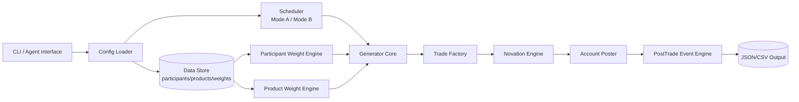

# DailyTradeSimulationGenerator 实现说明

## 执行摘要

你的方向是对的，但要补三点：**不要把官方 participant 名单顺序误当成市场份额**；**兜底覆盖必须“预算感知”**，否则在低交易目标日会吞掉权重；**Real Exchange 模式必须按产品区分会话**，因为entity["organization","HKFE Clearing Corporation","Hong Kong derivatives clearing house"]产品里，entity["stock","Hang Seng Index","Hong Kong benchmark stock index"]/entity["stock","Hang Seng China Enterprises Index","Hong Kong H-share stock index"]等指数产品有日盘+T+1，股票期权无夜盘且无竞价，个股期货也是日盘且现金结算。DCASS 是 HKCC/SEOCH 共用的单一清算系统；低中等量可走 Online/manual，高量更适合 OAPI。citeturn12view0turn17search0turn8search1turn8search4turn11view0turn10view1

## 架构图

下图去掉了 report generation，只保留可执行的生成、清算、存储与导出路径。DCASS 支持 post-trade manual 与 OAPI，两种都应在适配层保留。citeturn12view0turn9search12



## 数据模型

| 类 | 核心字段 | 含义 | 示例 |
|---|---|---|---|
| Participant | `id:String, dcass_code:String, ch:Symbol, role_tags:Array, base_weight:Float, floor_txn:Int` | 清算参与者主数据 | `hkcc_cmpf` |
| Product | `id, market, ch, product_type, hkats_code, base_weight, session_key, underlying_id` | 合约/产品主数据 | `HSI_FUT`, `TCH_OPT` |
| Underlying | `code:String, hkats_code:String, asset_type:Symbol, base_weight:Float, floor_txn:Int` | 标的主数据 | `0700/TCH` |
| Account | `id, participant_id, account_type:Symbol, margin_basis:Symbol` | House/Client/Daily等 | `A_HOUSE` |
| WeightProfile | `participant_bias, product_bias, temperature, max_share, coverage_floor` | 权重策略参数 | `market_maker_bias:1.3` |
| TransactionSpec | `buy_participant, sell_participant, product_id, qty, px, ts` | 单笔待生成规格 | `2026-05-11T09:31` |
| ScenarioConfig | `business_date, mode, total_txn_target, sessions, seed` | 运行场景 | `seed: 42` |
| TradeRecord | `trade_id, product_id, buyer, seller, qty, px, trade_time` | 原始成交 | `TR000001` |
| NovatedTrade | `trade_id, leg, cp_id, account_id, side, qty, px` | novation 后清算腿 | `BUY/HKCC` |
| Position | `participant_id, account_id, product_id, long_qty, short_qty, net_qty` | 聚合持仓 | `net_qty: 12` |

注：字段如 `role_tags / session_key / temperature` 为模拟器扩展；DCASS 内部枚举未公开者应标记“未公开/推断”。citeturn12view0turn0search3

## 权重分配策略

**Participant 层**：官方可直接拿到的是 roster，不是成交排名；因此建议把 HKCC/SEOCH General Clearing Participants 作为 universe，用 YAML 明确 high-weight 集合。示例高权重代码可先放：HKCC `CMPF/CGSA/CMLF/CMSA/CHBC/CUWD/CSGS/CJPM/CKGI`；SEOCH 可在此基础上加 `CBCM/CWAT`。兜底规则用“两段式”：先给每 participant 分 `floor_txn=N`，若 `Σfloor > target * 25%`，自动切换为**轮转覆盖**（按 business_date hash 只覆盖一部分 participant）。这样既保证覆盖，也不会在小样本日失真。citeturn2view0turn2view1

**Bias**：  
`effective_weight = base_weight × role_bias × session_bias × product_affinity`  
其中 `role_bias` 默认：`market_maker=1.30, institutional=1.15, retail=0.85`。因为交易所明确存在 PMM/CQMM/QRMM 等 market-maker 机制，给这类 participant 更高权重是合理的；但仍应由配置覆盖。citeturn15search0turn11view0turn10view1

**Product/Underlying 层**：HKCC 核心篮子建议以 HSI/HHI 及其 mini 版本做“强基座”，再加 HSTECH、USD/CNH 和少量 stock futures。HKEX 2025 年结果材料明确指出：HSI & HSCEI products 是强基座，增长来自 stock options、HS TECH 和 USD/CNH futures。Stock futures 官方列表中可直接选 `HKB(0005) / TCH(0700) / HEX(0388) / ALB(9988) / PAI(2318)`。SEOCH 则优先使用 16 只 weekly stock options 标的中的高活跃蓝筹，如 url腾讯https://www.tencent.com(0700/TCH)、url阿里巴巴https://www.alibabagroup.com(9988/ALB)、url友邦https://www.aia.com(1299/AIA)、url汇丰https://www.hsbc.com(0005/HKB)、url长和https://www.ckh.com.hk(0001/CKH)。对低权重 underlying，用同样的**floor+轮转覆盖**。citeturn13view0turn14view0turn14view2turn15search0turn5view0turn8search4

**抽样算法**：默认用**温度化 softmax + multinomial**；高仿真模式可选 **Dirichlet-Multinomial**。  
`p_i = softmax(log(w_i)/τ)`，`τ=0.8~1.2`；然后对剩余额度做多项式采样，并应用 `min/max share` 约束。Ruby 默认先实现 alias sampler；Dirichlet 用 `Gamma` 采样作为可选模块。日内默认分布：指数 AHT 产品 `早45/午25/夜30`，股票期权 `早55/午45/夜0`，stock futures `早55/午45/夜0`。citeturn8search1turn8search4turn11view0turn10view1turn8search0

## 运行模式

**Transaction Target Mode**：输入 `business_date,total_txn_target,product_mix,participant_mix,seed`，一次性分配预算后生成成交列表。输出 JSON/CSV。适合批量回归。  

伪代码：
```ruby
load_config
alloc_participants!
alloc_products!
floors_then_weighted_fill!
total_txn_target.times { build_trade -> novate -> post_trade_stub }
dump_json_csv
```

**Real Exchange Trade Mode**：按 session 模拟时间序列。指数产品可按 9:15-12:00 / 13:00-16:30 / 17:15-03:00；股票期权按 9:30-12:00 / 13:00-16:00 且无竞价；stock futures 亦为 9:30-12:00 / 13:00-16:00、现金结算。DCASS 对 AHT 产品在 T+1 session cutoff 前允许 next-day post-trade，日终 batch 顺序为 SEOCH、HKCC、Evening Batch。citeturn8search1turn8search4turn11view0turn10view1turn12view0

伪代码：
```ruby
sessions.each do |s|
  buckets(s).each do |t|
    k = poisson(rate_profile[t])
    k.times { gen_order_or_trade(t) }
  end
end
persist_replay_manifest(seed:, config_digest:, event_count:)
```

**并发/重放**：Ruby MRI 下建议“单时钟调度 + 生产者/消费者队列”；生成可并发，提交排序必须单线程。随机数用 `Random.new(seed ^ session_hash ^ minute_idx)`；重放文件只需保存 `seed + config digest + business_date + event counter`。

## 分阶段 AI agent Prompts

- **阶段一：初始化数据加载**  
  任务：实现 `ConfigLoader` 与 models；输入 `config/*.yml`；输出 `lib/models/*.rb`, `lib/config_loader.rb`。  
  签名：`ConfigLoader.load(path) -> ScenarioConfig`。  
  测试：①合法 YAML 成功；②未知 `product_type` 抛错。  
  验收：symbolized keys、schema 校验、可 deterministic dump。

- **阶段二：权重引擎**  
  输入 `participants.yml/products.yml/weights.yml`；输出 `participant_weight_engine.rb/product_weight_engine.rb`。  
  签名：`allocate_budget(target:, date:, seed:) -> Hash`。  
  测试：① floor 生效；② `Σfloor` 超预算时切轮转覆盖。  
  验收：总量守恒、单 participant 不超过 `max_share`。

- **阶段三：Trade Factory 与 Novation Engine**  
  输入分配结果；输出 `trade_factory.rb/novation_engine.rb`。  
  签名：`build_trade(spec) -> TradeRecord`; `novate(trade) -> Array<NovatedTrade>`。  
  测试：① buy/sell 不同 participant；② novation 生成两腿。  
  验收：trade_id 唯一、可复现。

- **阶段四：两种 Scheduler**  
  输出 `scheduler_target.rb/scheduler_session.rb`。  
  签名：`run_target_mode(cfg)`、`run_real_mode(cfg)`。  
  测试：① 股票期权无夜盘；② HSI 有夜盘事件。  
  验收：时间序列单调、session 约束正确。

- **阶段五：Post-trade stub**  
  输出 `post_trade_engine.rb`。  
  签名：`simulate_events(trades, rates:)`。  
  测试：① give-up/take-up；② rectify；并提供 `spin_off_context_stub(product_id)`。  
  验收：仅改交易/持仓，不生成报表。

- **阶段六：E2E smoke + replay**  
  输出 `bin/run`, `bin/replay`, `spec/e2e_spec.rb`。  
  测试：① 同 seed 输出一致；② 不同 seed 输出不同。  
  验收：JSON/CSV 可落盘，可回放。

## YAML 配置模板

下面的 participant 与 product 示例均来自官方 GCP/产品列表；夜盘映射来自官方 trading hours。citeturn2view0turn2view1turn15search0turn14view0turn11view0turn10view1turn8search4

```yaml
seed: 42
business_date: 2026-05-11
mode: target

participants:
  - id: hkcc_cmpf
    dcass_code: CMPF
    ch: hkcc
    role_tags: [market_maker, institutional]
    base_weight: 8.0
    floor_txn: 2
  - id: hkcc_chbc
    dcass_code: CHBC
    ch: hkcc
    role_tags: [institutional]
    base_weight: 7.0
    floor_txn: 1
  - id: seoch_cwat
    dcass_code: CWAT
    ch: seoch
    role_tags: [retail]
    base_weight: 4.0
    floor_txn: 1

products:
  - id: HSI_FUT
    ch: hkcc
    product_type: index_futures
    hkats_code: HSI
    base_weight: 10
    session_key: idx_aht
  - id: HHI_FUT
    ch: hkcc
    product_type: index_futures
    hkats_code: HHI
    base_weight: 8
    session_key: idx_aht
  - id: TCH_STKF
    ch: hkcc
    product_type: stock_futures
    hkats_code: TCH
    underlying_code: "0700"
    base_weight: 5
    session_key: day_only
  - id: TCH_OPT
    ch: seoch
    product_type: stock_option
    hkats_code: TCH
    underlying_code: "0700"
    base_weight: 9
    session_key: stockopt_day

weights:
  participant_bias: { market_maker: 1.3, institutional: 1.15, retail: 0.85 }
  temperature: 0.95
  max_share: 0.20
  coverage_floor_ratio_limit: 0.25

sessions:
  idx_aht:
    - [ "09:15", "12:00", 1.0 ]
    - [ "13:00", "16:30", 0.7 ]
    - [ "17:15", "03:00", 0.6 ]
  stockopt_day:
    - [ "09:30", "12:00", 1.0 ]
    - [ "13:00", "16:00", 0.8 ]
  day_only:
    - [ "09:30", "12:00", 1.0 ]
    - [ "13:00", "16:00", 0.8 ]
```

## 参考资料、风险与工期

**优先资料**  
P1：urlDCASS User Guide Ch1turn9search2；urlSEOCH OCPturn17search15；urlHKCC Clearing Procedures Ch2turn16search6；urlHKEX Clearing Services Novation 页面turn17search0；urlDerivatives Trading Hoursturn0search1。  
P2：urlWeekly Stock Options 列表turn3search0；urlStock Options 列表turn15search0；urlStock Futures 页面turn6search1；urlHKCC GCP 名单turn1search5；urlSEOCH GCP 名单turn1search7；urlNasdaq Genium CW1 Guideturn0search3。  

**风险与缓解**：  
权重偏差——不要把 roster 当 market share，使用 YAML 覆盖；随机性——固定 seed+manifest；并发——生成并发、提交串行；覆盖过度——用 `coverage_floor_ratio_limit`；时间冲突——按 session map 限制产品时段；内部未公开字段一律标“未公开/推断”。citeturn2view0turn2view1turn12view0

**工期与交付物**：  
阶段一至六建议 `0.5d / 1d / 1d / 1.5d / 1d / 0.5d`，总计约 **5.5 人日**。交付物：`lib/models`, `lib/engines`, `lib/schedulers`, `config/*.yml`, `bin/run`, `bin/replay`, `spec/*`, `sample_output/*.json|csv`。